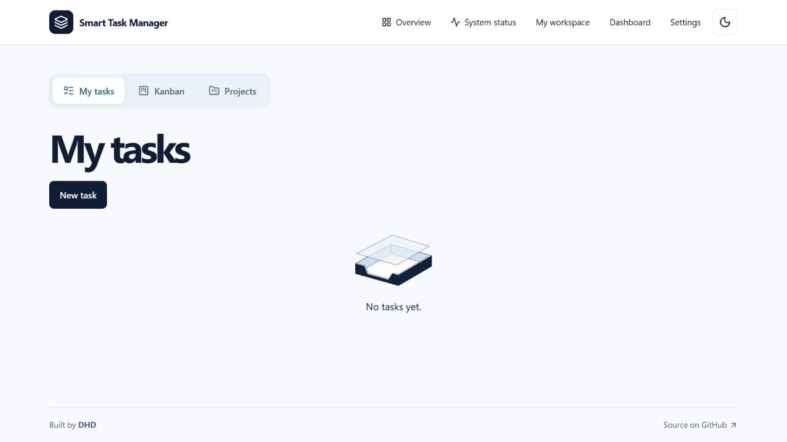
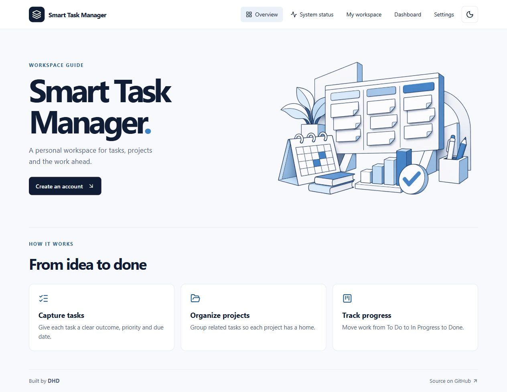

# Smart Task Manager

**English** · Personal task management with secure accounts, projects, Kanban, deadlines, analytics and light/dark themes.

**Français** · Gestion personnelle des tâches avec comptes sécurisés, projets, Kanban, échéances, statistiques et thèmes clair/sombre.

**Site / Live:** https://smart-task-manager-production-4de23843.up.railway.app

**API + MySQL:** https://smart-task-manager-production-4de23843.up.railway.app/api/ready




## Installation locale / Local setup

Node.js 24 LTS, npm and a dedicated MySQL-compatible database are required. / Node.js 24 LTS et une base MySQL dédiée sont nécessaires.

```sh
git clone https://github.com/DHD-04/smart-task-manager.git
cd smart-task-manager
npm ci
cp .env.example .env
```

PowerShell: `Copy-Item .env.example .env`. Configure DATABASE_URL in .env with your dedicated database credentials. Percent-encode reserved characters. / Configurez DATABASE_URL avec les identifiants de votre base dédiée.

```sh
npm run db:generate
npm run db:migrate
npm run dev
```

Open / Ouvrir http://localhost:5173. API: http://localhost:3001. Create your account with a password of at least 12 characters. / Créez votre compte avec un mot de passe de 12 caractères minimum.

## Features / Fonctionnalités

- Secure registration, login/logout and protected routes / Inscription, connexion et routes protégées.
- Task/project CRUD, priority, status, deadlines and deletion confirmation / Gestion complète des tâches et projets.
- Three-column Kanban, drag-and-drop, keyboard/mobile status controls, search and filters / Kanban avec recherche et filtres.
- User-specific statistics, completion, overdue/upcoming tasks and charts / Statistiques personnelles et graphiques.
- Profile editing, persistent themes, responsive UI, original illustrations and modern workspace tabs / Profil, thèmes, illustrations et onglets modernisés.

## Architecture

| Layer / Couche | Implementation |
| --- | --- |
| Client | React 19, TypeScript, Vite, Router, Tailwind, Lucide, dnd-kit, Recharts |
| API | Express 5, routes → controllers → services → Prisma |
| Production | Docker React + Express on one HTTPS origin, separate MySQL service with volume |
| Security / Sécurité | scrypt passwords, hashed session tokens, Secure/HttpOnly/SameSite cookies, origin checks, Helmet, auth rate limiting |
| Tests | Vitest, Supertest, React Testing Library |

A User owns Projects, Tasks and Sessions. A Task optionally belongs to a Project; a composite foreign key enforces matching ownership. Status and deadline indexes are scoped per user. Detach tasks before deleting a project. Two versioned Prisma migrations initialize the schema and sessions.

Un utilisateur possède ses projets, tâches et sessions. Une clé étrangère composée impose le même propriétaire pour une tâche et son projet. Les migrations sont versionnées. La connexion API–MySQL utilise le réseau privé Railway.

## Verification / Vérification

```sh
npm test
npm run build
npm audit --omit=dev
```

Set AUTH_DB_TEST=1 against a dedicated test database to include integration tests (PowerShell: `$env:AUTH_DB_TEST='1'`). Otherwise database tests are skipped. / Activez cette variable sur une base dédiée pour les tests d’intégration.

2026-11-16: all 11 tests passed, build passed and production audit found zero known vulnerabilities. / 11 tests réussis, compilation réussie, aucune vulnérabilité connue dans les dépendances de production.

Set VERIFY_URL to the HTTPS origin and run `node scripts/verify-production.mjs` for the live smoke test. It creates two accounts, verifies secure cookies, authentication, CRUD, persistence across sessions, account isolation and dashboard totals; it removes its tasks/projects and leaves empty test accounts. Only run on your own deployment.

Le parcours navigateur d’inscription et les nouveaux onglets ont été vérifiés sur le site public. Trois comptes de test vides subsistent après les vérifications de livraison ; leurs identifiants ne sont pas conservés.

## Deployment and limits / Déploiement et limites

[DEPLOYMENT.md](DEPLOYMENT.md) contains the API routes and hosting procedure. Docker runs migrations before startup; Express serves client/dist in production. Railway supplies TLS and PORT (8080 in this deployment). / Le Dockerfile lance les migrations puis sert le client et l’API à la même adresse HTTPS.

Railway trial: 30 days or USD 5 credit. Continued hosting after credit expiry is not guaranteed; no paid plan was enabled. Backups/restoration, load tests and physical touch hardware remain unverified. Password recovery and shared team projects are not included. Portfolio unchanged.

Essai Railway : 30 jours ou 5 USD de crédit, sans garantie de disponibilité après épuisement. Aucun abonnement payant activé. Sauvegarde/restauration, tests de charge et matériel tactile physique non validés. Pas de récupération de mot de passe ni de projets partagés dans cette version. Portfolio inchangé.

## Actual history / Historique réel

| Milestone / Jalon | Actual date / Date réelle | Commit |
| --- | --- | --- |
| 1 · Foundation | 2026-11-09 | 9c2eb78 |
| 2 · Authentication | 2026-11-10 | 1b8e7eb |
| 3 · CRUD | 2026-11-11 | 0c87aaa |
| 4 · Kanban | 2026-11-12 | 9bf14dc |
| 5 · Analytics | 2026-11-15 | 414412a |
| 6 · UI/UX | 2026-11-16 | 3d8d3df |
| 7 · Production | 2026-11-16 | See PROGRESS.md |

November 13–14 were missed. Milestones 6 and 7 were completed November 16 at the user's explicit request: seven milestones across six dates, not seven distinct days. No commit dates altered. The daily schedule ended November 15.

Les 13 et 14 novembre ont été manqués. Les jalons 6 et 7 ont été réalisés le 16 novembre à la demande explicite de l’utilisateur : sept jalons sur six dates, sans antidatage. La planification quotidienne est arrêtée.

[Roadmap](ROADMAP.md) · [Progress](PROGRESS.md)

**Doha Hanine Daoudi — DHD** · [GitHub](https://github.com/DHD-04)
