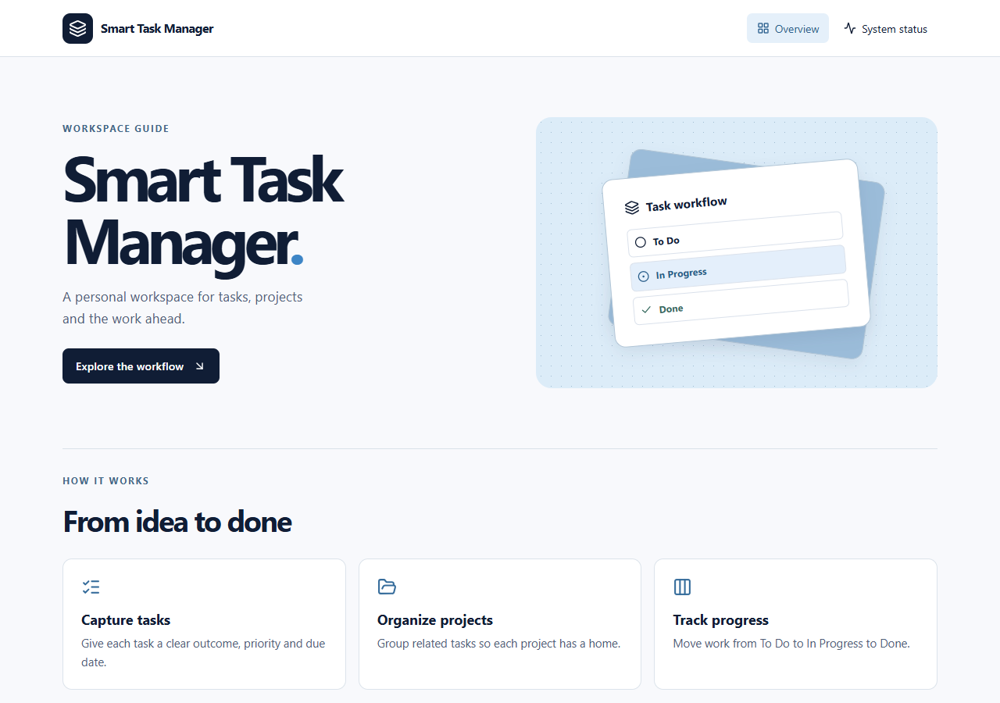

# Smart Task Manager

**English** · A personal task workspace built over seven real development days. Day 1 provides the responsive overview, live system status, Express API and relational database foundation.

**Français** · Un espace personnel de gestion des tâches, développé sur sept jours distincts. Le premier jalon comprend la page d’accueil responsive, l’état des services en temps réel, l’API Express et le schéma relationnel.



## Run locally / Installation locale

Use Node.js 24 LTS, npm and a local MySQL-compatible database. Create a dedicated database and grant a local application account the privileges required to apply its migrations. The initial migration was exercised on MariaDB 10.4 through Prisma's MySQL provider.

Utilisez Node.js 24 LTS, npm et une base compatible MySQL. Créez une base dédiée et un compte local autorisé à y appliquer les migrations. Dans le fichier `.env`, renseignez l’URL de cette base avec les identifiants de ce compte.

```sh
git clone https://github.com/DHD-04/smart-task-manager.git
cd smart-task-manager
npm ci
cp .env.example .env
```

On PowerShell / Sous PowerShell, use `Copy-Item .env.example .env`. Set `DATABASE_URL` in `.env` before proceeding. Percent-encode reserved characters in credentials. `PORT` defaults to 3001.

```sh
npm run db:generate
npm run db:migrate
npm run dev
```

Open the Vite URL printed in the terminal, normally `http://localhost:5173`. Ouvrez cette adresse puis **System status** pour vérifier la connexion entre le navigateur, Express et la base.

## Architecture

| Layer / Couche | Implementation |
| --- | --- |
| Client | React, TypeScript, Vite, React Router, Tailwind CSS, Lucide |
| HTTP | Express → routes → controllers → services → Prisma |
| Database / Base | MySQL provider, versioned SQL migration / migration SQL versionnée |
| Checks / Tests | TypeScript, Vitest, Supertest |

A user owns projects and tasks. A task can belong to a project. A composite foreign key enforces matching ownership. Status and due date are indexed per user. Project deletion requires detaching its tasks first.

Chaque utilisateur possède ses projets et ses tâches. Une clé étrangère composée garantit qu’une tâche et son projet appartiennent au même utilisateur. Le statut et l’échéance sont indexés par utilisateur. Les tâches doivent être détachées avant de supprimer un projet.

## API

| Method | Route | Response / Réponse |
| --- | --- | --- |
| GET | `/api/health` | 200 · Express is running / API active |
| GET | `/api/ready` | 200 · database connected / base connectée. 503 · database unavailable / base indisponible |

## Verification / Vérification

```sh
npm test
npm run build
npm audit
```

The build writes the frontend to `client/dist` and the API to `server/dist`. After building, `npm start` runs the compiled API. Vite proxies local requests under `/api` to Express.

La compilation produit le client dans `client/dist` et le serveur dans `server/dist`. Après compilation, `npm start` lance l’API. En développement, Vite transmet les requêtes `/api` à Express.

## Deployment / Déploiement

Local development is available at Day 1. Day 7 includes HTTPS hosting, production MySQL, session and CRUD checks, and publication of the verified URLs. Le déploiement public et les tests de persistance en production sont prévus au septième jour.

## Roadmap / Feuille de route

1. Foundation / Initialisation
2. Authentication / Authentification
3. Task and project management / Gestion des tâches et projets
4. Kanban, search and filters / Kanban, recherche et filtres
5. Dashboard and analytics / Tableau de bord et statistiques
6. Responsive UI, themes and accessibility / Interface, thèmes et accessibilité
7. Production testing and deployment / Tests et déploiement

[Milestones / Jalons](ROADMAP.md) · [Progress / Avancement](PROGRESS.md)

**Doha Hanine Daoudi — DHD** · [GitHub](https://github.com/DHD-04)
